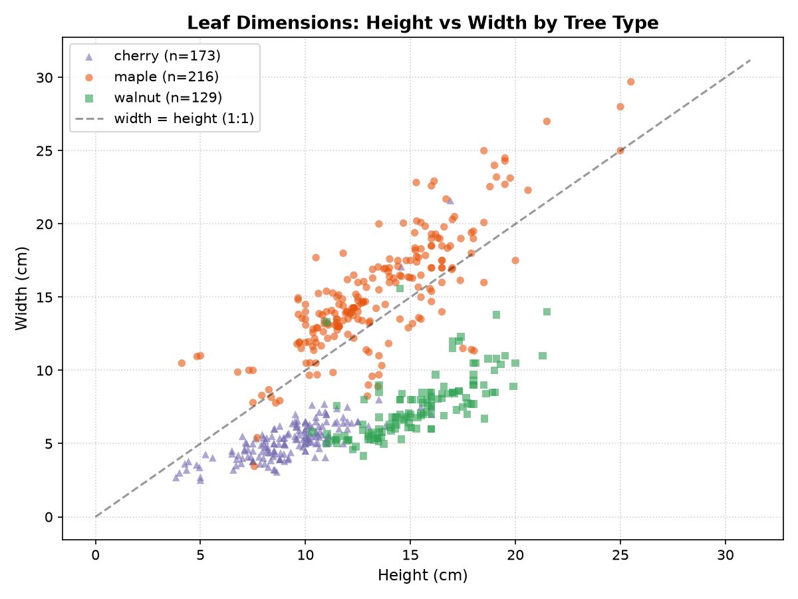
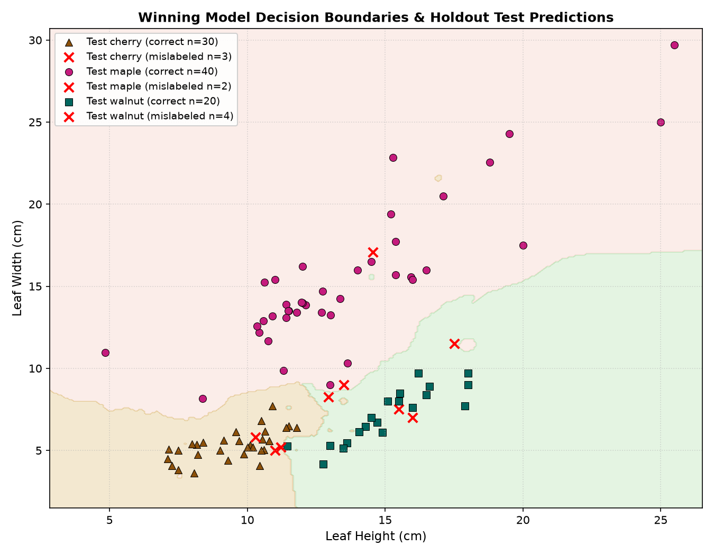

```{python}
#| include: false
import json
import pandas as pd

# Load dataset and counts
df_raw = pd.read_csv("leaves.csv")
n_raw = len(df_raw)
df_unique = df_raw.drop_duplicates()
n_unique = len(df_unique)
n_dups = n_raw - n_unique
dup_pct = f"{n_dups / n_raw * 100:.1f}%"
counts = df_unique.iloc[:, 2].value_counts().to_dict()
count_maple = counts.get("maple", 0)
count_cherry = counts.get("cherry", 0)
count_walnut = counts.get("walnut", 0)

# Load baseline metrics
with open("results/baseline_results.json") as f:
    baseline = json.load(f)
base_acc = baseline["cv_mean_accuracy"] * 100
base_acc_str = f"{base_acc:.1f}%"
base_f1 = baseline["cv_mean_macro_f1"]
base_f1_str = f"{base_f1:.3f}"

# Load best model info
with open("results/best_model_info.json") as f:
    best_info = json.load(f)
best_family = best_info["best_model_family"]

# Load final test metrics
with open("results/test_metrics.json") as f:
    test_res = json.load(f)
test_acc = test_res["test_accuracy"] * 100
test_acc_str = f"{test_acc:.2f}%"
test_f1 = test_res["test_macro_f1"]
test_f1_str = f"{test_f1:.4f}"
acc_gain = test_acc - base_acc
acc_gain_str = f"+{acc_gain:.1f}%"
cm = test_res["confusion_matrix"]
```

## Slide 1: Goal & Research Question

::: {.slide-container}
::: {.col-half}
::: {.card}
<div class="card-title">🎯 Research Question & Morphology</div>

**Can physical leaf dimensions reliably classify tree species?**

- **Input Features**: Only two scalar measurements:
  - `Leaf height` (cm) — tip to stem attachment
  - `Leaf width` (cm) — maximum lateral span
- **Target Species & Characteristics**:
  - **Maple** (*Acer*) — broad, palmate, bimodal size distribution ($4 \dots 25.5$ cm), 81% wider than tall
  - **Cherry** (*Prunus*) — small, compact, oval leaves ($3.8 \dots 16.9$ cm height, typically $4 \dots 6$ cm width)
  - **Walnut** (*Juglans*) — elongated, slender compound leaflets ($10.3 \dots 21.5$ cm height, high aspect ratio)
:::
:::

::: {.col-half}
::: {.card-primary}
<div class="card-title">📋 Evaluation Rules & Success Criteria</div>

- **Zero Data Leakage**: Isolate test holdout before any model fitting or preprocessing.
- **Pre-split Deduplication**: Eliminate 26 exact repeats so no test sample has an identical twin in train.
- **5-Fold Stratified CV**: Balance fold distributions and tune hyperparameters via Macro F1.
- **Success Threshold**: Beat naive majority-class guessing (`{python} base_acc_str`) by at least 40 percentage points ($>82.2\%$).
- **Strict Final Testing**: Evaluate the chosen model strictly once on the 99-sample holdout test set.
:::
:::
:::

## Slide 2: Data Exploration & Anomalies (Step 1)

::: {.slide-container}
::: {.col-half}
<div class="img-box">
  
</div>
:::

::: {.col-half}
::: {.card}
<div class="card-title">📊 Dataset Composition & Class Balance</div>

- **Total raw observations**: **`{python} n_raw`** rows
- **Exact duplicate rows**: **`{python} n_dups`** rows (`{python} dup_pct`) $\to$ severe leakage risk if unhandled!
- **Unique physical specimens**: **`{python} n_unique`** leaves
  - **Maple**: `{python} count_maple` leaves (42.3%)
  - **Cherry**: `{python} count_cherry` leaves (32.9%)
  - **Walnut**: `{python} count_walnut` leaves (24.8%)
:::

::: {.card-warn}
<div class="card-title">⚠️ Critical Data Anomalies Identified</div>

- **2 Cherry Outliers**: Rows 214 & 390 have width $> 17$ cm, lying deep inside the maple cluster (label noise / data entry error).
- **Dual Precision Fingerprint**: 316 rows rounded to 1–2 decimals vs. 202 rows with 6 decimals (synthetic jittering).
:::
:::
:::

## Slide 3: Validation Protocol & Baseline (Steps 2 & 3)

::: {.slide-container}
::: {.col-half}
::: {.card}
<div class="card-title">🛡️ 4-Stage Experimental Protocol</div>

1. **Deduplication**: 518 raw $\to$ 492 unique samples before splitting.
2. **Stratified Holdout Split (80 / 20)**:
   - **Train**: 393 samples (used for 5-fold CV & model selection)
   - **Test**: 99 samples (locked away until final test)
3. **5-Fold Stratified Cross-Validation**: Preserves identical class proportions across all validation folds (`random_state=42`).
4. **Macro F1-score Selection**: Unweighted average across classes prevents favoring majority maple.
:::
:::

::: {.col-half}
::: {.card-primary}
<div class="card-title">📉 Naive Baseline Model</div>

`DummyClassifier(strategy='most_frequent')` predicts **Maple** for every sample:

<div class="stat-box">
  <span class="stat-val">`{python} base_acc_str`</span>
  <span class="stat-badge-warn">Baseline CV Accuracy</span>
</div>

<div class="stat-box">
  <span class="stat-val">`{python} base_f1_str`</span>
  <span class="stat-badge-warn">Baseline CV Macro F1</span>
</div>

<p class="stat-sub">
Required target threshold: <strong>&ge; 82.2%</strong> test accuracy (+40 percentage points over baseline).
</p>
:::
:::
:::

## Slide 4: Model Tuning & Comparison (Step 4)

::: {.slide-container}
::: {.col-full}
::: {.card}
<div class="card-title">🔬 5-Fold Stratified CV Results (53 Configurations Tested)</div>

<table class="table-compact">
  <thead>
    <tr>
      <th>Model Family</th>
      <th>Best Hyperparameter Configuration</th>
      <th>CV Macro F1</th>
      <th>CV Accuracy</th>
    </tr>
  </thead>
  <tbody>
    <tr class="highlight-row">
      <td><strong>K-Nearest Neighbors</strong></td>
      <td>StandardScaler + k=7, weights='distance'</td>
      <td><strong>0.9556</strong> &plusmn; 0.016</td>
      <td><strong>95.67%</strong></td>
    </tr>
    <tr>
      <td><strong>Random Forest</strong></td>
      <td>n_estimators=50, max_depth=8, min_samples_split=5</td>
      <td>0.9389 &plusmn; 0.019</td>
      <td>94.15%</td>
    </tr>
    <tr>
      <td><strong>Decision Tree</strong></td>
      <td>max_depth=5, min_samples_split=10</td>
      <td>0.9322 &plusmn; 0.016</td>
      <td>93.64%</td>
    </tr>
    <tr>
      <td><strong>Logistic Regression</strong></td>
      <td>StandardScaler + C=1.0, max_iter=1000</td>
      <td>0.9280 &plusmn; 0.021</td>
      <td>93.13%</td>
    </tr>
  </tbody>
</table>
:::

::: {.card-primary}
<div class="card-title">🏆 Winning Architecture: K-Nearest Neighbors (k=7)</div>

Distance weighting provides smooth, local non-linear decision boundaries that cleanly capture the bimodal cluster shape of maples and the curved separation boundary between cherry and walnut.
:::
:::
:::

## Slide 5: Final Holdout Test Evaluation (Step 5)

::: {.slide-container}
::: {.col-half}
<div class="img-box">
  
</div>
:::

::: {.col-half}
::: {.card-primary}
<div class="card-title">🎯 Out-of-Sample Performance (99 Test Samples)</div>

<div class="stat-box">
  <span class="stat-val">`{python} test_acc_str`</span>
  <span class="stat-badge">Test Accuracy (`{python} acc_gain_str` vs Baseline)</span>
</div>

<div class="stat-box">
  <span class="stat-val">`{python} test_f1_str`</span>
  <span class="stat-badge">Test Macro F1 Score</span>
</div>
:::

::: {.card}
<div class="card-title">🔍 Holdout Confusion Matrix & Error Analysis</div>

<table class="table-compact">
  <thead>
    <tr>
      <th>True \ Pred</th>
      <th>Cherry</th>
      <th>Maple</th>
      <th>Walnut</th>
    </tr>
  </thead>
  <tbody>
    <tr><td><strong>Cherry (33)</strong></td><td><strong>30</strong></td><td>1 <em>(outlier)</em></td><td>2</td></tr>
    <tr><td><strong>Maple (42)</strong></td><td>0</td><td><strong>40</strong></td><td>2</td></tr>
    <tr><td><strong>Walnut (24)</strong></td><td>3</td><td>1</td><td><strong>20</strong></td></tr>
  </tbody>
</table>

<p style="font-size: 0.88rem; color: #475569; margin-top: 8px;">
Only 9 total errors: 1 mislabeled cherry outlier ($14.6 \times 17.1$ cm) + 8 subtle border overlaps between cherry and walnut.
</p>
:::
:::
:::
