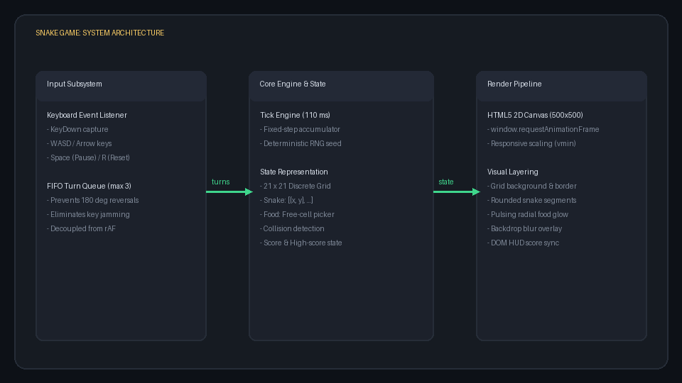
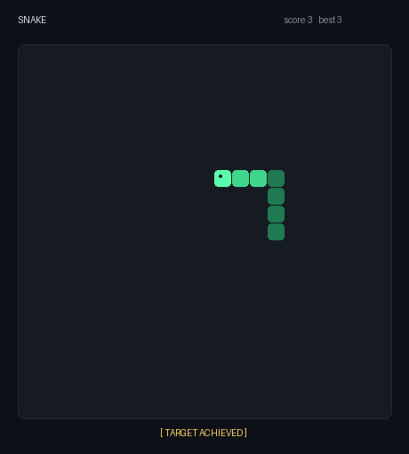

## Overview

A deterministic, modern HTML5 implementation of the classic arcade Snake.

* **Tech Stack**: Vanilla JavaScript, Canvas 2D, CSS custom properties.
* **Architecture**: Decoupled rendering and fixed-frequency simulation.
* **Verification**: Deterministic replay testing over Chrome DevTools Protocol.

::: {.notes}
Welcome everyone. Today we are presenting the architecture and implementation of our retro Snake game. 
Our focus here is on precision, decoupled timing, and automated verification without external framework dependencies.
:::

## System Architecture

{fig-align="center" width="85%"}

::: {.notes}
To address the feedback of avoiding text overload, this diagram captures the entire runtime pipeline:
First, the input subsystem buffers keystrokes into a FIFO turn queue to prevent 180-degree self-collisions and key jamming.
Second, the core state runs on a fixed 110ms tick accumulator with deterministic PRNG seeding.
Third, the render pipeline utilizes requestAnimationFrame to scale the 21-by-21 grid seamlessly onto the 500-by-500 canvas.
:::

## Live Gameplay Dynamics

{fig-align="center" width="60%"}

::: {.notes}
Here we observe the game dynamics in action.
Notice that the initial frame displays the target final state with score 3 and snake length 7.
As the animation runs, the snake moves smoothly, executes buffered turns, consumes food pellets, and expands in length.
The final state is held statically at the conclusion of the loop.
:::

## Core Dimensions & Parameters

| Metric / Dimension | Value | Architectural Purpose |
|:-------------------|:------|:----------------------|
| **Grid Resolution** | $21 \times 21$ cells | Symmetric odd-dimension arena with exact center start |
| **Canvas Resolution** | $500 \times 500$ px | High-DPI viewport mapped to `min(90vmin, 560px)` |
| **Cell Dimensions** | $23.8 \times 23.8$ px | Discrete unit step per movement tick |
| **Tick Interval** | $110$ ms ($9.09$ Hz) | Balanced game speed with responsive input latency |
| **Initial Length** | $4$ segments | Standard baseline starting at $(10, 10)$ |

::: {.notes}
This slide summarizes the critical quantitative specifications.
The 21-by-21 grid allows an exact center origin for initial placement.
The tick interval of 110 milliseconds provides optimal human reflex timing while allowing automated headless testing over CDP.
:::

## Execution & Verification

* **Launch Game**:
  ```bash
  open snake/index.html
  ```
* **Run Headless Automation**:
  ```bash
  uv run --with websocket-client python /tmp/drive_snake.py
  ```
* **Repository Link**: [github.com/kafcoo/mlr-agent-lab](https://github.com/kafcoo/mlr-agent-lab)

::: {.notes}
Finally, running and verifying the game is straightforward.
The standalone HTML can be launched directly in any modern browser with zero build step.
Automated verification is conducted using uv with websocket-client to steer the snake through CDP and assert collision safety.
:::
